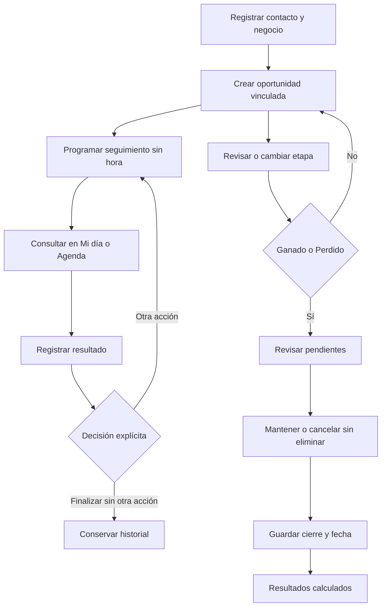

# Flujo principal implementado

## Contacto y oportunidad

Nombre y negocio son obligatorios; número, necesidad, preferencia y notas son opcionales. Se propone un origen editable. Los números iniciales `000 000 001` y similares son marcadores ficticios, no números operativos. No hay enlaces de llamada ni envío.

Una persona admite varias oportunidades. Cada una distingue necesidad financiera, categoría de producto y etapa comercial. Las categorías son financiamiento para capital de trabajo o maquinaria, cuenta de ahorro y cuenta para gestionar ingresos del negocio. **Monto solicitado** es opcional y solo existe para financiamiento; se oculta en las cuentas. El contacto no se cambia desde la oportunidad para conservar la relación con sus seguimientos.

## Mi día y Agenda

Mi día incluye pendientes hasta hoy, próximos y realizados, con sus reglas de orden. Al consultar una fila se actualiza el panel; si el registro deja de coincidir con el filtro se limpia la selección. En móvil se usa un diálogo de detalle. La Agenda permite filtrar la fecha, usar la lista o consultar el mes. Los seguimientos son acciones del día, sin horarios inventados.

## Tablero y cambios de etapa

El Kanban conserva seis etapas. El conteo respeta búsqueda y filtro. Las tarjetas muestran el caso concreto: persona/negocio, necesidad, producto, monto solicitado solo si es financiamiento y próxima acción del asesor. No incorporan definiciones extensas. **Editar o cambiar etapa** permite operar con teclado; el arrastre abre el mismo formulario sin guardar al soltar.

## Cierre y alternativas

- Ganado o Perdido registra fecha de cierre.
- Propuesta enviada significa información comercial compartida. Ganado representa un cierre comercial de la demo; no aprueba una solicitud ni implica desembolso.
- Perdido exige motivo; Otro exige explicación.
- Si hay pendientes se debe elegir mantenerlos o cancelarlos. Se explican ambas consecuencias antes de guardar.
- Los cancelados se conservan en el historial. Los mantenidos se pueden completar, cancelar o reprogramar.
- Reabrir limpia fecha y motivo de cierre, registra actividad y no reactiva seguimientos cancelados.
- Completar exige resultado y elegir programar otra acción o finalizar sin otra acción. El guardado del resultado y la próxima acción es conjunto.

## Errores y persistencia

La validación conserva lo escrito. Los datos inválidos no se sustituyen automáticamente. El esquema v3 conserva productos anteriores como sin clasificar, incluidos sus importes históricos, y no los interpreta como solicitudes. La lectura no escribe. **Cargar demostración financiera** solicita confirmación para reemplazar contactos, oportunidades, seguimientos e historial con los nuevos ejemplos. Cancelar no modifica el almacenamiento.

Las acciones de ejemplo son consultar cuánto financiamiento necesita, comprender su destino, coordinar una conversación, explicar información general del producto y confirmar si desea continuar. No se incorporan condiciones oficiales ni evaluación crediticia.
