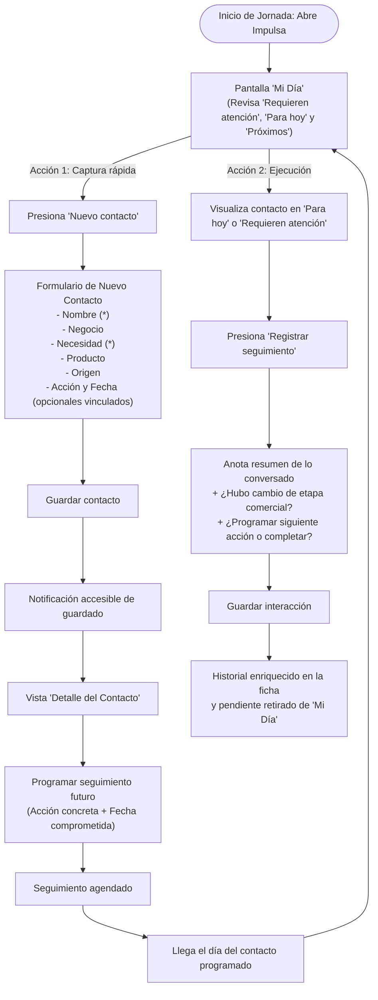

# Flujo Principal de Registro y Seguimiento — Impulsa

## 1. Diagrama del Recorrido Principal

El flujo de usuario está diseñado para resolver la fricción entre la captación en campo y el seguimiento oportuno:

---

## 2. Descripción Paso a Paso del Recorrido

### Paso 1: Inicio del día y orientación
- **Objetivo del usuario:** Saber inmediatamente a quién atender y qué prioridad tienen sus pendientes.
- **Punto de contacto:** Pantalla **Mi día**.
- **Jerarquía visual:**
  1. **Encabezado contextual:** Muestra la fecha actual en español (ej. *Domingo, 8 de noviembre*) para situar al asesor en el día.
  2. **Tres indicadores compactos:** Vencidos, Para hoy y Próximos días en superficies neutras con acentos sutiles de estado.
  3. **Lista priorizada de seguimientos por secciones:**
     - *Requieren atención:* Los contactos postergados encabezan la lista para recuperar la relación.
     - *Para hoy:* Compromisos pactados para la jornada presente.
     - *Próximos seguimientos:* Horizonte de contactos futuros.
  4. **Tarjeta de contacto:** Muestra iniciales del titular en avatar, nombre en alta jerarquía, nombre del negocio, etiqueta temporal (*Hoy*, *Hace 2 días*), necesidad del cliente y bloque destacado de *Próxima acción* con fondo suave.

### Paso 2: Captación y registro de nuevo contacto
- **Objetivo del usuario:** Registrar un prospecto rápidamente sin perder tiempo ni memorizar formularios complejos.
- **Acción:** Presionar el botón principal visible **"Nuevo contacto"** (única acción principal en el encabezado).
- **Interacción del formulario:**
  - Campos esenciales requeridos: *Nombre* y *Necesidad detectada*.
  - Campos contextuales opcionales: *Nombre del negocio*, *Producto de interés* (categorías genéricas: Financiamiento, Ahorro, Servicios de pago) y *Origen del contacto* (Referido, Campaña, Visita).
  - Sección de seguimiento inicial: Si el asesor ya acordó una llamada o visita, puede ingresar la acción y la fecha. La validación exige que si se define una fecha, se especifique la acción y viceversa.
- **Resultado:** Se guarda el registro en `localStorage`, se lanza una notificación accesible (toast) y se abre la ficha detallada del contacto.

### Paso 3: Consulta y preparación del contexto
- **Objetivo del usuario:** Antes de comunicarse, recordar qué habló previamente y qué busca el emprendedor.
- **Punto de contacto:** Pantalla de **Detalle del contacto**.
- **Estructura mental:**
  - **Bloque de Información General:** Avatar con iniciales, nombre, negocio, etapa comercial (con selector accesible) y origen.
  - **Caja de Próxima Acción (Futuro):** Ubicada en la parte superior con fecha límite destacada, botón para registrar la llamada y botón para reprogramar o marcar como realizado.
  - **Historial de Conversaciones (Pasado):** Bitácora cronológica inmutable con fechas legibles, canal utilizado (llamada, visita, mensaje) y notas inmutables de acuerdos previos.

### Paso 4: Ejecución y registro de la conversación
- **Objetivo del usuario:** Marcar la tarea como completada y dejar constancia de lo ocurrido.
- **Acción:** Presionar **"Registrar seguimiento"** (disponible tanto desde la tarjeta en *Mi día* como desde la ficha de detalle).
- **Entrada de datos:**
  - Canal de comunicación realizado (llamada, visita, mensaje u otro).
  - Campo de texto para notas de la llamada o visita.
  - Opción de actualizar la etapa comercial de la oportunidad (ejemplo: de *Contactado* a *Interesado*).
  - Opción de programar la siguiente acción inmediata (acción + fecha).
- **Resultado:**
  - La conversación se agrega al historial inmutable del contacto.
  - El seguimiento anterior queda cerrado y desaparece de la sección de vencidos/hoy de *Mi día*.
  - Si se programó una nueva fecha, se recalcula la presencia del contacto en *Mi día* según la nueva fecha.

### Paso 5: Cierre de la oportunidad comercial
- **Objetivo del usuario:** Concluir el proceso cuando el cliente concretó la operación o decidió desistir.
- **Acción:** Cambiar la etapa a **"Cerrado con venta"** o **"Cerrado sin venta"**.
- **Reglas de diseño:**
  - Si se selecciona *Cerrado sin venta*, el sistema despliega un campo opcional para registrar el motivo de pérdida.
  - Si el contacto tiene un seguimiento pendiente en la agenda, el sistema solicita explícitamente decidir si se completa dicho seguimiento o se mantiene activo.
