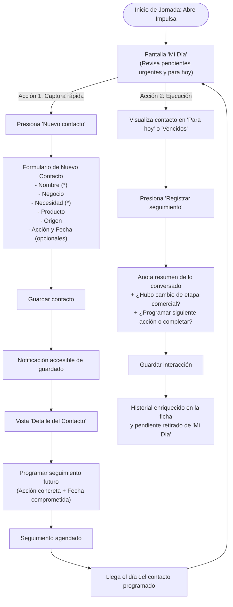

# Flujo Principal de Registro y Seguimiento — Impulsa

## 1. Diagrama del Recorrido Principal

El flujo de usuario está diseñado para resolver la fricción entre la captación en campo y el seguimiento oportuno:

---

## 2. Descripción Paso a Paso del Recorrido

### Paso 1: Inicio del día y orientación
- **Objetivo del usuario:** Saber inmediatamente a quién atender y qué prioridad tienen sus pendientes.
- **Punto de contacto:** Pantalla **Mi día**.
- **Jerarquía visual:**
  1. Contadores rápidos de resumen: Vencidos (alerta sutil), Para hoy (atención inmediata), Próximos (horizonte de 7 días).
  2. Lista priorizada de seguimientos: primero los atrasados para recuperar la relación, luego los agendados para la fecha actual.
  3. Cada elemento muestra: Nombre del titular, nombre comercial, necesidad principal y fecha pactada.

### Paso 2: Captación y registro de nuevo contacto
- **Objetivo del usuario:** Registrar un prospecto rápidamente sin perder tiempo.
- **Acción:** Presionar el botón principal visible **"Nuevo contacto"**.
- **Interacción del formulario:**
  - Campos esenciales requeridos: *Nombre* y *Necesidad detectada*.
  - Campos contextuales opcionales: *Nombre del negocio*, *Producto de interés* (categorías genéricas: Financiamiento, Ahorro, Servicios de pago) y *Origen del contacto* (Referido, Campaña, Visita).
  - Sección de seguimiento inicial: Si el asesor ya acordó una llamada o visita, puede ingresar la acción y la fecha. La validación exige que si se define una fecha, se especifique la acción y viceversa.
- **Resultado:** Se guarda el registro en el almacenamiento local y se abre la ficha detallada del contacto, con un mensaje accesible de confirmación.

### Paso 3: Consulta y preparación del contexto
- **Objetivo del usuario:** Antes de comunicarse, recordar qué habló previamente y qué busca el cliente.
- **Punto de contacto:** Pantalla de **Detalle del contacto**.
- **Estructura mental:**
  - **Cabecera:** Nombre, negocio, etapa comercial actual y etiqueta de origen.
  - **Bloque de Necesidad:** Descripción textual de lo que busca el emprendedor.
  - **Caja de Próxima Acción Pendiente:** Destacada en la parte superior con fecha límite y botón de acción rápida para completarla.
  - **Línea de Tiempo / Historial de Conversaciones:** Registro cronológico de notas pasadas con fecha y resultado de cada interacción, visualmente separado de las tareas pendientes.

### Paso 4: Ejecución y registro de la conversación
- **Objetivo del usuario:** Marcar la tarea como completada y dejar constancia de lo ocurrido.
- **Acción:** Presionar **"Registrar seguimiento"** (disponible tanto desde la tarjeta en *Mi día* como desde la ficha de detalle).
- **Entrada de datos:**
  - Campo de texto para notas de la llamada o visita (ejemplo: *"Conversé con el dueño, revisó la proforma y está de acuerdo con el plazo"*).
  - Opción de actualizar la etapa comercial de la oportunidad (ejemplo: pasa de *Contactado* a *Interesado*).
  - Opción de agendar la siguiente acción inmediata (ejemplo: *"Recoger documentos firmados el viernes"*).
- **Resultado:**
  - La conversación se agrega al historial inmutable del contacto.
  - El seguimiento anterior queda cerrado y desaparece de la sección de vencidos/hoy de *Mi día*.
  - Si se programó una nueva fecha, se recalcula la presencia del contacto en *Mi día* según la nueva fecha.

### Paso 5: Cierre de la oportunidad comercial
- **Objetivo del usuario:** Concluir el proceso cuando el cliente concretó la operación o decidió desistir.
- **Acción:** Cambiar la etapa a **"Cerrado con venta"** o **"Cerrado sin venta"**.
- **Reglas de diseño:**
  - Si se selecciona *Cerrado sin venta*, el sistema despliega un campo opcional para registrar el motivo de pérdida (ejemplo: *"Prefirió postergar compra para el próximo año"* o *"Optó por utilizar fondos propios"*).
  - Si el contacto tiene un seguimiento pendiente en la agenda, el sistema solicita explícitamente al usuario decidir si desea dar por concluido dicho seguimiento o mantenerlo activo.
